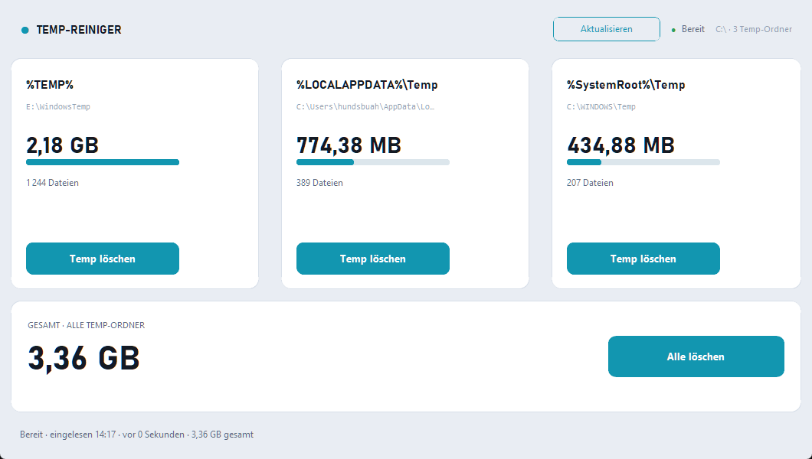

# 🧹 Temp-Reiniger

**Windows-Tool, das drei Temp-Ordner auf einen Blick zeigt und sicher leert.**
Kein Blindlöschen, keine Wurzelmappen-Gefahr — du siehst, wie „schwer" jeder
Ordner ist, und entscheidest gezielt, was geleert wird.




---

## ✨ Features

- **Drei Temp-Ordner** als Karten nebeneinander:

  | # | Umgebungsvariable | Typischer Pfad |
  |---|---|---|
  | 1 | `%TEMP%` | `C:\Users\<du>\AppData\Local\Temp` |
  | 2 | `%LOCALAPPDATA%\Temp` | `C:\Users\<du>\AppData\Local\Temp` |
  | 3 | `%SystemRoot%\Temp` | `C:\Windows\Temp` |

- **Größe & Dateianzahl** pro Ordner — plus **Gesamtsumme** über alle
  eindeutigen (physischen) Temp-Ordner; zeigt `%TEMP%` auf denselben Ordner
  wie `%LOCALAPPDATA%\Temp`, zählt das Gesamt ihn nur einmal.
- **Relative Füllstand-Leiste** pro Karte: man sieht sofort, welcher Ordner am
  schwersten ist.
- **Gezielt leeren** (`Temp löschen`) oder **alles auf einmal** (`Alle löschen`).
- **Zwei-Stufen-Bestätigung** („Wirklich löschen?") statt störendem Modal.
- **Auto-Rescan** nach dem Leeren + Anzeige der **freigemachten Größe** (MB/GB).
- **`Aktualisieren`**-Button (Refresh) zum erneuten Einlesen.
- **System-Tray:** Fenster minimiert ins Tray; Linksklick öffnet das Fenster,
  per Rechtsklick die 4 Lösch-Optionen.
- **Reaktionsschnell:** Scan/Lösch laufen im Hintergrund, die UI friert nicht ein.

## 🔒 Sicherheit

- Beim Start wird **nichts gelöscht** — nur eingelesen.
- **Wurzelmappen bleiben immer** — es wird ausschließlich der *Inhalt* entfernt.
- **Pfad-Validierung:** jeder Temp-Pfad muss absolut sein, kein Laufwerksroot
  oder Netzpfad und auf einen Temp-Ordner zeigen (letzte Komponente endet auf
  `Temp`). Unzulässige Pfade (z. B. `%TEMP%=C:\Windows`) werden weder
  gescannt noch gelöscht — die Karte ist entsprechend markiert.
- **Single-Instance:** eine zweite Instanz wird abgelehnt (benannter Mutex) —
  paralleles Leeren desselben Ordners ist nicht möglich.
- Gesperrte bzw. in-Benutzung-Dateien werden **übersprungen** (kein Abbruch);
  nicht lesbare Ordner (z. B. ohne Leserecht) werden als „nicht lesbar“ gezählt
  (Status amber).
- Unerwartete Fehler landen zusätzlich in `%LOCALAPPDATA%\Temp-Reiniger\error.log`
  (die windowed EXE hat keine Konsole).
- Deutsches Zahlformat (`2,34 GB`, `1 244 Dateien`) und klare Statusmeldungen.

## 🚀 Installation & Start

### Option A — Fertige EXE (empfohlen)
Die fertige EXE als **GitHub-Release** laden: **[Temp-Reiniger.exe](https://github.com/Hundsbuah/temp_reiniger/releases)**
(v1.3.0). Single-File, ohne Python-Installation — einmal klicken und los.

### Option B — Aus dem Quellcode
```bash
git clone https://github.com/Hundsbuah/temp_reiniger.git
cd temp_reiniger
pip install -r requirements.txt
python temp_reiniger.py
```

## 📦 EXE selbst bauen (PyInstaller)

Kanonischer Build-Pfad: **PyInstaller pinnen** und die **Spec aus dem Repo**
verwenden (bewusst ohne UPX — der Build liefert kein UPX aus):

```bash
pip install "pyinstaller>=6.0,<7"
pyinstaller Temp-Reiniger.spec
```

→ Ergebnis: **`dist\Temp-Reiniger.exe`** (eine einzige EXE).

> `dist/` ist im Repo git-ignoriert — die fertige EXE wird als **GitHub-Release**
> ausgeliefert, nicht als Datei im Repository.

## 🧪 Dev-Modi (nur für Tests/Screenshots, nicht produktiv)

| Variable | Wirkung |
|---|---|
| `TEMP_REINIGER_MOCK=1` | synthetische Demo-Größen; der Start-Scan wird unterdrückt (reines Layout-Bild) |
| `TEMP_REINIGER_SCREENSHOT=<pfad>` | Fenster rendern + Screenshot speichern (mit MOCK = Demo-Werte) |
| `TEMP_REINIGER_LAUNCH_CHECK=1` | UI + Tray aufbauen, ~2,5 s warten, `launch_check.txt` schreiben (`OK` / `NO-TRAY`) und sauber beenden |

Priorität: `LAUNCH_CHECK` vor `SCREENSHOT`. Die Beendigung läuft über den
regulären Quit-Pfad (Tray-Icon wird sauber gestoppt).

**In der gebauten EXE sind `MOCK` und `SCREENSHOT` deaktiviert** (ignoriert —
keine vorgetäuschten Demo-Größen vor echten Deletes). `LAUNCH_CHECK` bleibt
zerstörungsfrei erhalten und verifiziert gebaute EXEs: UI + Tray aufbauen,
nichts löschen, sauber beenden.

## 🖥️ System-Tray

Fenster minimieren oder schließen → die App verschwindet aus der Taskleiste und
läuft als **Tray-Icon** weiter — soweit das Tray-Icon verfügbar ist. Ein
1-s-Health-Check erkennt ein nachweislich fehlendes Icon und schaltet die App
um: dann beendet **Schließen** die App (einmaliger Status-Hinweis) und ein
verstecktes Fenster wird zurückgeholt. *Grenze (pystray): Nach einem
Explorer-Neustart kann das Icon verschwinden, ohne dass die App das merken
kann (pystray 0.19.x reagiert nicht auf `TaskbarCreated`); dann hilft ein
Beenden über den Task-Manager und Neustart.*


**Linksklick** aufs Icon öffnet das Fenster (Default-Item).
**Rechtsklick** im Tray:

- `%TEMP% leeren`
- `%LOCALAPPDATA%\Temp leeren`
- `%SystemRoot%\Temp leeren`
- `Alle Temp-Ordner leeren`
- ──────────
- `Fenster öffnen`
- `Temp-Reiniger beenden`

## ⚙️ Hinweise

- **`C:\Windows\Temp`** lässt sich ohne Admin-Rechte oft nur teilweise leeren →
  für die volle Wirkung die App **als Administrator starten**. Gesperrte Dateien
  werden in jedem Fall übersprungen; Ordner ohne Leserecht werden zusätzlich als
  „nicht lesbar“ gezählt (Status amber — die Löschung ist dann NICHT vollständig).
- **`%TEMP%` und `%LOCALAPPDATA%\Temp`** zeigen häufig auf denselben Ordner. Die
  App erkennt das, zeigt einen Hinweis und leert ihn bei „Alle löschen" nur einmal.
- **Symlinks/Junctions** im Temp-Inhalt werden nie gefolgt: der Link wird
  entfernt, das Ziel bleibt unangetastet (auch Junctions, die `islink` nicht
  sieht — Reparse-Point-Prüfung).
- **Sehr tiefe Dateipfade (> 260 Zeichen):** Windows-MAX_PATH-Limit — solche
  Einträge werden übersprungen, die App bricht nie ab.
- **Gesamt** = Summe der **eindeutigen** (physischen) Temp-Ordner — zeigt
  `%TEMP%` auf denselben Ordner wie `%LOCALAPPDATA%\Temp`, zählt das Gesamt
  ihn nur einmal (die Karten zeigen jeweils ihre eigene Größe; Duplikat-
  Hinweis wird angezeigt).
- Tray- und Button-Löschungen sind **explizite Auswahl**; es gibt keinen
  Auto-Start-Löschmodus.
- **Beenden während eines laufenden Deletes** bricht es ab; ein erneuter Lauf
  vollendet die Löschung (idempotent).

## 🧱 Aufbau

| Datei / Bereich | Zweck |
|---|---|
| `temp_reiniger.py` | gesamte App (UI, Logik, Tray) in einer Datei |
| `DESIGN.md` | Design-System: Farben, Typo, Layout, Zustände, Motion |
| `PRODUCT.md` | Produkt-Kontext, Zielgruppe, Annahmen |
| `requirements.txt` | Abhängigkeiten für den Quellcode-Start |
| `dist/` | lokale Build-Ausgabe (git-ignoriert; EXE wird als Release ausgeliefert) |
| `graphify-out/` | Wissensgraph des Projekts (Graphify) |

**Abhängigkeiten:** `customtkinter` (UI), `pystray` (Tray, reines ctypes —
**kein** `pywin32`), `Pillow` (Tray-Icon / Dev).

## 🎨 Design

Helles, kühles Slate, matte weiße Karten, ein klares Teal-Akzent — bewusst keine
„Klappergel-Buttons". Zahlen in der industriellen **Bahnschrift**, Pfade in
**Consolas**. Signatur-Element: die relativen **Füllstand-Leisten** und die
großen Ziffern. Details im [Design-Dokument](DESIGN.md).

## 📄 Lizenz

Noch keine Lizenz hinterlegt — siehe den Lizenz-Bereich auf GitHub.